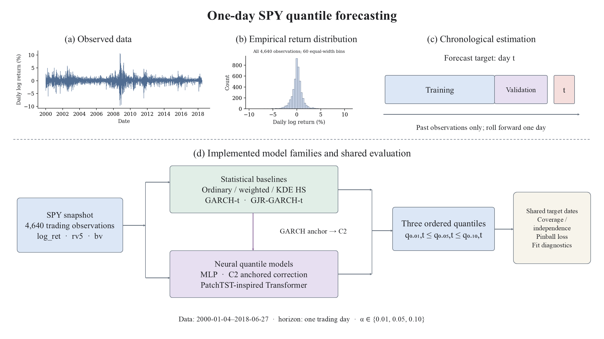
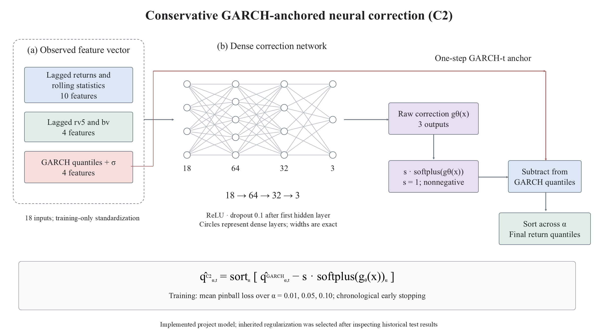
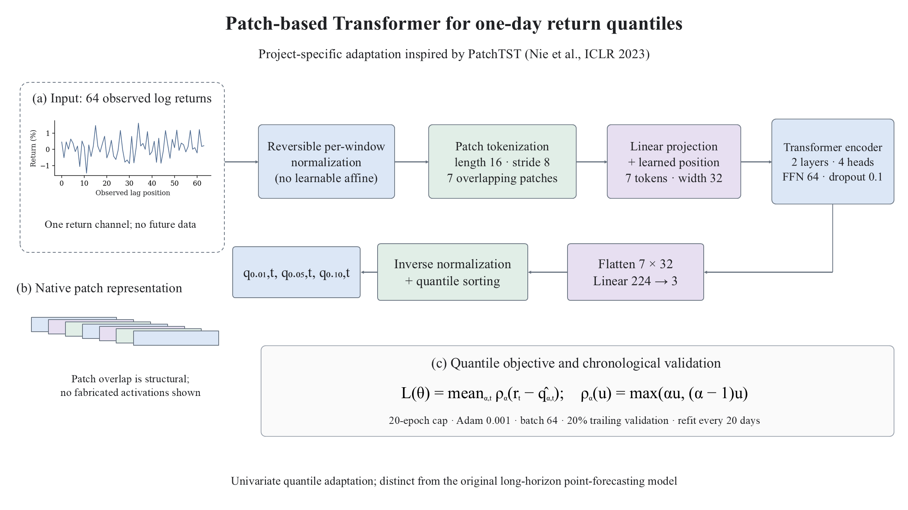
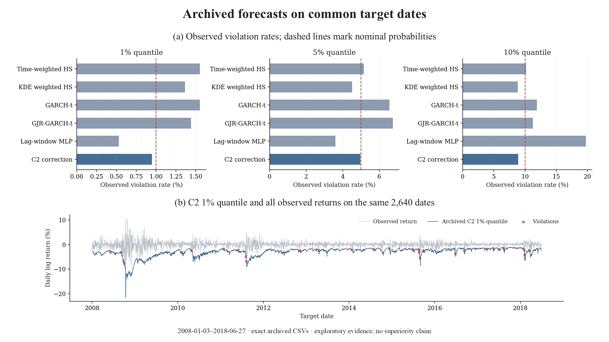

# SPY VaR
### Classical and neural models for one-day tail-risk forecasting

[Report](Final_Report_Single.pdf) · [Methods](docs/METHODS.md) · [Results](#empirical-results) · [Reproduce](#reproduce) · [References](docs/REFERENCES.md) · [Editable figures](docs/figures/spy_var_methods.pptx)

A reproducible study of **1%, 5% and 10% conditional return quantiles** for SPY.
The project combines statistical volatility models, neural quantile regression,
and a conservative GARCH-anchored correction, with an additional
**PatchTST-inspired quantile Transformer** trained from scratch.

  

**Figure 1. Research workflow.** Numerical panels use the included SPY snapshot.
The model and evaluation blocks correspond to executable code.

## Study at a glance

| Item | Specification |
| --- | --- |
| Instrument and period | SPY; 2000-01-04–2018-06-27 |
| Data | 4,640 observations; decimal log returns, rv5 and bv |
| Task | One-trading-day-ahead lower return quantiles |
| Quantile levels | 0.01, 0.05, 0.10 |
| New-run estimation window | 1,000 observations; explicit model-specific refit schedules |
| Evaluation | Common finite target dates; coverage, independence and pinball loss |
| Evidence | Preserved historical forecasts and separately reported new three-seed Transformer runs |

The research question is whether structured volatility information and controlled
nonlinear corrections can improve tail-risk calibration. **No single model is
assumed to dominate.** Coverage calibration and forecast loss answer different
questions, and a non-rejected backtest is not proof that a model is correct.

## Models and scientific basis

| Model | Actual implementation | Basis / status |
| --- | --- | --- |
| Ordinary HS | Equal-weight empirical quantile | Transparent statistical baseline |
| Time-weighted HS | Exponential age weights, decay 0.98 | Inverse weighted empirical CDF |
| KDE weighted HS | Weighted Gaussian KDE, Scott bandwidth | Smoothed distributional baseline |
| GARCH-t | Constant mean, GARCH(1,1), standardized Student-t innovations | [Bollerslev, 1986](https://doi.org/10.1016/0304-4076(86)90063-1) |
| GJR-GARCH-t | Asymmetric conditional variance, Student-t innovations | [Glosten et al., 1993](https://doi.org/10.1111/j.1540-6261.1993.tb05128.x) |
| MLP quantile regression | Lag-window MLP, 64→32→3, pinball loss | Project baseline; [quantile objective](https://doi.org/10.2307/1913643) |
| C2 anchored correction | 18→64→32→3; nonnegative softplus correction subtracted from GARCH quantiles | Project-specific exploratory model |
| Patch-based quantile Transformer | 64 returns → 7 patches → 2 encoder layers → 3 quantiles | Project adaptation of [PatchTST, ICLR 2023](https://arxiv.org/abs/2211.14730) |

Canonical implementations are under [src/spy_var/models](src/spy_var/models).
[Methods](docs/METHODS.md) states the information available at each forecast
date and distinguishes project changes from the cited original methods.

### Conservative GARCH-anchored correction

  

**Figure 2. Implemented C2 architecture.** Circle counts are schematic;
the labeled layer widths and feature dimensions are exact. The historical C2
regularization setting was selected after inspecting test-period results, so
its calibration evidence remains exploratory.

### Patch-based quantile Transformer

  

**Figure 3. Implemented neural extension.** This is a small one-day quantile
adaptation inspired by PatchTST, not the original authors' long-horizon
point-forecasting model. It replaces MSE with pinball loss and uses
[RevIN-style](https://openreview.net/forum?id=cGDAkQo1C0p) per-window normalization
without learnable affine parameters. The exact 18,531-parameter configuration
and all implementation differences are [documented](docs/METHODS.md).

## Empirical results

### Archived common-date comparison

All six rows below use the **same 2,640 target dates, 2008-01-03–2018-06-27**,
and the **1%** quantile. The table is recomputed from the preserved predictions;
it is not a new training run. Losses are in decimal-return units.

<!-- BEGIN HISTORICAL_RESULTS -->
| Model | Violations / 2,640 | Rate | Kupiec p | Independence p | Pinball loss |
| --- | ---: | ---: | ---: | ---: | ---: |
| Time-weighted HS | 41 | 1.55% | 0.00825 | 0.0275 | 0.000410 |
| KDE weighted HS | 36 | 1.36% | 0.0752 | 0.0127 | 0.000400 |
| GARCH-t | 41 | 1.55% | 0.00825 | 0.163 | 0.000358 |
| GJR-GARCH-t | 38 | 1.44% | 0.0333 | 0.577 | 0.000334 |
| Lag-window MLP | 14 | 0.53% | 0.00772 | 0.699 | 0.001523 |
| C2 correction | 25 | 0.95% | 0.782 | 0.0217 | 0.000350 |
<!-- END HISTORICAL_RESULTS -->

C2 has near-nominal unconditional coverage in this sample, while its 1%
independence test rejects at the unadjusted 5% level. GJR-GARCH has lower
pinball loss in this comparison. These observations support a calibration/loss
trade-off, rather than a claim of uniform neural-model superiority.

  

**Figure 4. Actual archived forecasts.** The top row uses all three quantiles;
the lower panel includes all observed returns and C2 1% violations on the
aligned dates. [Complete final table](docs/results/historical_comparison.csv).

### New Transformer runs

The fixed [configuration](configs/modern_quantile.json) was run from scratch
with **seeds 42, 43 and 44** on the complete snapshot. Each seed yields **3,640
forecasts**. These runs use a longer evaluation period than the archived
C2-aligned table and are therefore reported separately.

<!-- BEGIN MODERN_RESULTS -->
| Nominal quantile | Observed rate, mean ± SD | Pinball loss, mean ± SD | Dates per seed |
| --- | ---: | ---: | ---: |
| 1% | 2.26% ± 0.10 pp | 0.000389 ± 0.000004 | 3640 |
| 5% | 5.60% ± 0.22 pp | 0.001243 ± 0.000011 | 3640 |
| 10% | 10.13% ± 0.35 pp | 0.001997 ± 0.000006 | 3640 |
<!-- END MODERN_RESULTS -->

SD is the sample standard deviation across optimization seeds; **pp** means
percentage points. It is not a confidence interval and does not increase the
number of independent market observations. The 1% forecasts remain
under-calibrated: actual violations average about 2.26%, and the per-seed
unconditional-coverage tests reject. This extension is an evaluated comparison
model, not an asserted improvement.

[Per-seed metrics](docs/results/patch_transformer_by_seed.csv) ·
[Final summary](docs/results/patch_transformer_summary.csv) ·
[Experiment fingerprints and checks](docs/EXPERIMENTS.md)

## Reproduce

Use **Python 3.12**. From the repository root:

~~~sh
python -m venv .venv
# Windows PowerShell:
.\.venv\Scripts\Activate.ps1
# macOS / Linux: source .venv/bin/activate
python -m pip install -r requirements-lock.txt
~~~

**Evaluate archived predictions**, with no model fitting:

~~~sh
python scripts/reproduce.py evaluate --include-c2 --output ../spy-var-runs/cached-c2
~~~

**Check all model families** on a small chronological sample:

~~~sh
python scripts/reproduce.py train --config configs/smoke.json --max-observations 160 --output ../spy-var-runs/smoke
~~~

**Reproduce the new full-snapshot neural experiment:**

~~~sh
python scripts/reproduce.py train --config configs/modern_quantile.json --seeds 42 43 44 --output ../spy-var-runs/patch-seeds
~~~

The baseline and full C2 configurations remain available under
[configs](configs). Run directories record expanded settings, data/code
fingerprints, predictions, optimizer diagnostics and dated training losses.
Existing nonempty output directories are rejected. Detailed runs and figure
build files stay outside the checkout; only compact final evidence is retained.

[Complete reproduction guide](docs/REPRODUCIBILITY.md) ·
[Executed validation](docs/VALIDATION.md)

## Repository structure

~~~text
SPY_VaR/
├── configs/                 # Explicit baseline, C2, Transformer and smoke settings
├── src/spy_var/
│   ├── models/              # Statistical, MLP, anchored and patch models
│   ├── data.py              # Chronological snapshot validation
│   ├── artifacts.py         # One registry for historical prediction files
│   ├── backtesting.py       # Common-sample statistical evaluation
│   └── pipeline.py          # Experiments, provenance and seed summaries
├── scripts/                 # Reproduction and final figure/result publication
├── tests/                   # Timing, statistics, model and evidence checks
├── docs/
│   ├── figures/             # Four final PNGs and their editable PPTX
│   ├── results/             # Compact, verified final metric tables
│   ├── METHODS.md
│   ├── EXPERIMENTS.md
│   └── REFERENCES.md
├── code/                    # Preserved report chapters, data and historical outputs
└── Final_Report_Single.pdf
~~~

The original chapter materials remain available for the report. New experiments
use a single canonical implementation and [data snapshot](code/data/README.md).

## Scope and limitations

This is a retrospective, single-asset historical study. Extreme-tail events are
sparse, C2's inherited regularization was selected after test inspection, and the
new Transformer does not achieve nominal 1% coverage. An independent future
sample is needed before making a confirmatory forecasting claim. The work does
not establish general superiority of neural methods or a trading strategy.

The diagrams are original, code-matched compositions. Their numerical panels
use real repository data. They were built with
[EditableImage2PPTSkill](https://github.com/soulmujoco/EditableImage2PPTSkill),
refined as native PowerPoint objects, and exported from the saved PPTX.
[Figure sources and README design references](docs/REFERENCES.md) include a
dated, conservative verification of the high-star reference selection.

## Citation and license

Use [CITATION.cff](CITATION.cff) and include the commit used in your experiment.
Original methods are credited in [References](docs/REFERENCES.md);
the project does not declare a paper DOI.

Code: [MIT](LICENSE). Homepage: [cloudcollection.github.io](https://cloudcollection.github.io).

