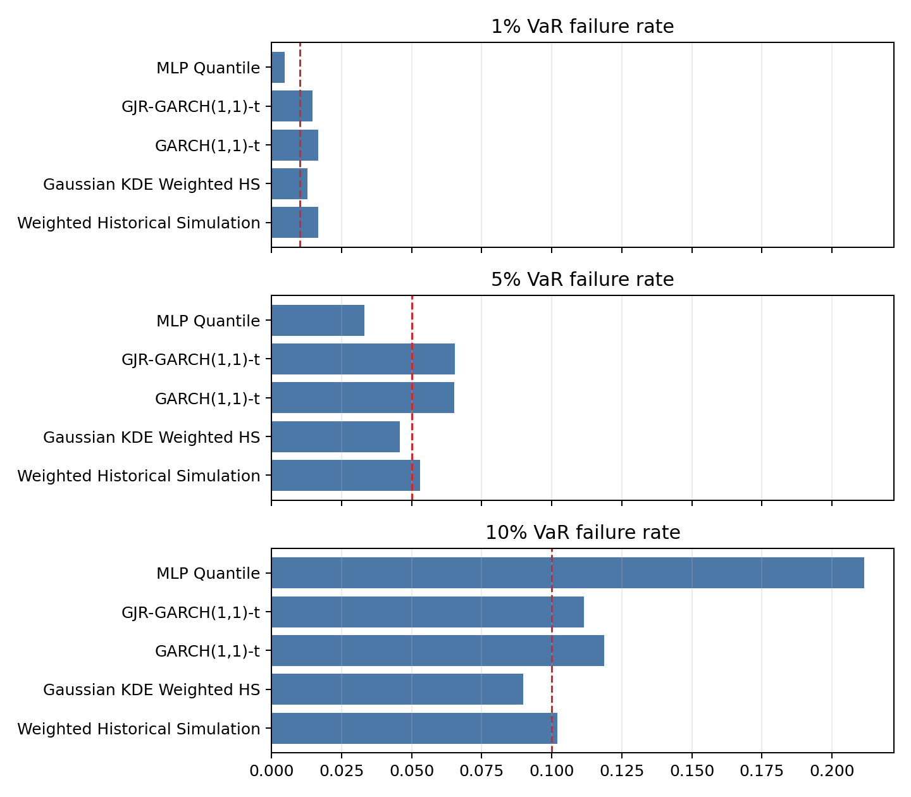

# SPY Value-at-Risk Forecasting

A research project on one-day-ahead downside risk forecasting for SPY, comparing
historical simulation, Student-t volatility models, and neural quantile methods
at the **1%, 5%, and 10% lower-tail probabilities**.

**[Full report](Final_Report_Single.pdf)** ·
**[Reproduction guide](docs/REPRODUCIBILITY.md)** ·
**[Data documentation](code/data/README.md)**

## Research question and findings

Can a neural correction to a structured GARCH forecast improve tail-risk
calibration? The historical study finds that no model satisfies every diagnostic:
historical simulation struggles with changing volatility; GARCH-family models
offer useful dynamics; unconstrained neural forecasts are unstable; a conservative
GARCH-anchored correction (C2) improves unconditional coverage in the reported
sample, while residual extreme-tail dependence remains. The report does not
establish uniform pinball-loss superiority over GARCH-family benchmarks.

**C2 is exploratory.** Its historical weight decay was selected after inspecting
final out-of-sample failure rates. Those results are not untouched test evidence.
The original report and saved outputs remain available for inspection; new
experiments are written separately with explicit configuration and provenance.



*Historical comparison from five saved prediction files. Dashed lines show target
violation rates. This is not the C2-aligned comparison from Chapter 6.*

## Quick start

Use **Python 3.12** and run from the repository root:

```sh
python -m venv .venv
# Windows PowerShell:
.\.venv\Scripts\Activate.ps1
# macOS / Linux: source .venv/bin/activate
python -m pip install -r requirements-lock.txt
```

The lock records versions verified on Windows x64 with Python 3.12.14. Neural
runs use CPU. Hardware/platform changes can affect numerical results.

### 1. Recalculate metrics from saved predictions

```sh
python scripts/reproduce.py evaluate --output results/cached-check
```

This trains **no models**. It reads the five existing forecast CSVs and saves
`tables/aligned_model_comparison.csv`, `tables/evaluation_dates.csv`,
`figures/aligned_failure_rates.png`, and `manifest.json` beneath the output directory.

To include the archived exploratory C2 predictions on a common, later sample:

```sh
python scripts/reproduce.py evaluate --include-c2 --output results/cached-c2-check
```

This six-model comparison covers the generic baselines plus C2. It does not
reconstruct Chapter 6's additional ordinary-HS and GARCH-X experiments.

### 2. Check the complete training pipeline on a small sample

```sh
python scripts/reproduce.py train --config configs/smoke.json --max-observations 160 --output results/smoke
```

This fits all seven model specifications using short windows and two neural
epochs. It checks that the workflow runs; its metrics are not research results.

### 3. Run new full-sample experiments

```sh
python scripts/reproduce.py train --config configs/baselines.json --output results/baselines
python scripts/reproduce.py train --config configs/full_exploratory.json --output results/full-exploratory
```

The first configuration fits six baselines, including ordinary HS. The second
adds C2. Full rolling fits take substantially longer than cached evaluation.
These are new, explicitly specified experiments; the migration does not claim
exact reconstruction of every historical report table.

For multiple seeds:

```sh
python scripts/reproduce.py train --config configs/full_exploratory.json --seeds 42 43 44 --output results/multiple-seeds
```

Every output directory must be new or empty. Existing results are never silently
overwritten. See the [reproduction guide](docs/REPRODUCIBILITY.md) for artifacts,
model timing, historical-table mapping and known research limitations.

## Models

| Configuration ID | Specification |
| --- | --- |
| `hs` | Ordinary equal-weighted empirical Historical Simulation |
| `weighted_hs` | Exponentially time-weighted HS; default decay 0.98 |
| `kde_hs` | Gaussian KDE-smoothed time-weighted HS; Scott bandwidth |
| `garch_t` | GARCH(1,1) with standardized Student-t innovations |
| `gjr_garch_t` | Asymmetric GJR-GARCH(1,1)-t |
| `mlp` | Lag-window MLP, trained with pinball loss and chronological early stopping |
| `c2` | Exploratory conservative neural correction anchored to GARCH-t |

The generic lag-window MLP is distinct from the Chapter 5 Model A/B
specifications. The archived file `var_historical_simulation.csv` contains
**time-weighted HS**, despite its abbreviated filename.

## Data and evaluation

The checked-in snapshot contains 4,640 daily observations from **2000-01-04 to
2018-06-27**: decimal log returns (`log_ret`) and two realized-volatility measures
(`rv5`, `bv`). Upstream source and redistribution terms are not yet documented
well enough to verify; see the [data note](code/data/README.md).

New comparisons use the same finite dates across models for each quantile,
reject conflicting realized returns, and report Kupiec coverage, Christoffersen
independence/conditional coverage, pinball loss and excluded-observation counts.
Independence transitions do not bridge missing trading observations. A larger
p-value is not a model-ranking score, and non-rejection is not proof of correctness.

## Repository layout

```text
SPY_VaR/
├── configs/                 # Explicit baseline, full and smoke settings
├── src/spy_var/             # Canonical data, models, backtesting and pipeline
├── scripts/reproduce.py     # Cached evaluation / training entry point
├── tests/                  # Timing, alignment and statistical boundary checks
├── docs/REPRODUCIBILITY.md  # Methods, provenance and migration notes
├── results/                # New local experiments (ignored by Git)
├── code/
│   ├── data/               # Canonical input snapshot and data documentation
│   ├── outputs/            # Preserved historical predictions, tables, figures
│   ├── scripts/            # Original scripts; main.py redirects to new pipeline
│   ├── sections/           # Preserved chapter sources and historical artifacts
│   └── run_all.py          # Compatibility entry point for cached evaluation
└── Final_Report_Single.pdf
```

Chapter copies remain an archive for the original report. New experiments use
one implementation and one data snapshot rather than modifying chapter copies.

## Validation

```sh
python -m pytest
```

GitHub Actions runs tests, both cached-evaluation paths and the seven-model smoke
experiment. The environment lock does not reconstruct the unknown original
training environment of the historical CSVs.

See the [validation record](docs/VALIDATION.md) for the checks actually run and
their limits.

## Author and license

Homepage: <https://cloudcollection.github.io>

Code is available under the [MIT license](LICENSE). The code license does not
establish third-party data rights. This repository has no declared publication
DOI; [citation metadata](CITATION.cff) identifies the maintainer by GitHub handle.
Include the commit/release used for your experiment when citing the repository.


