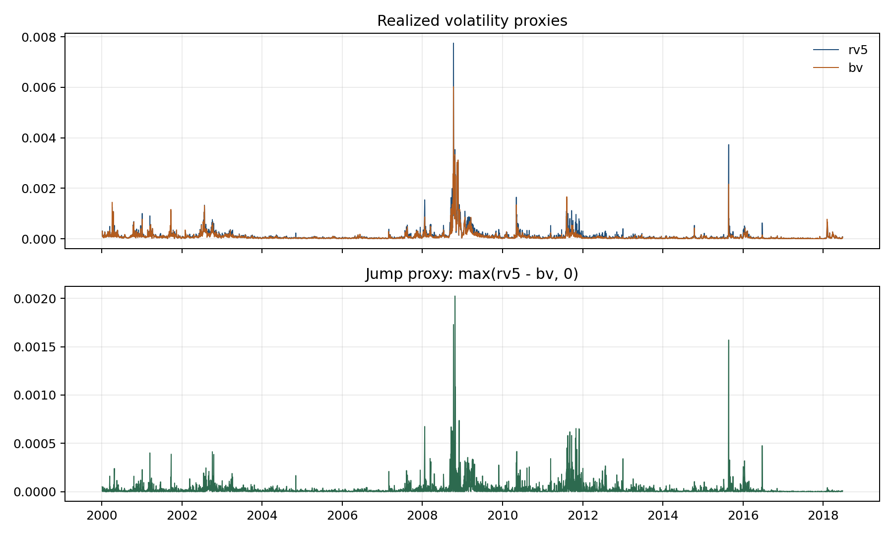
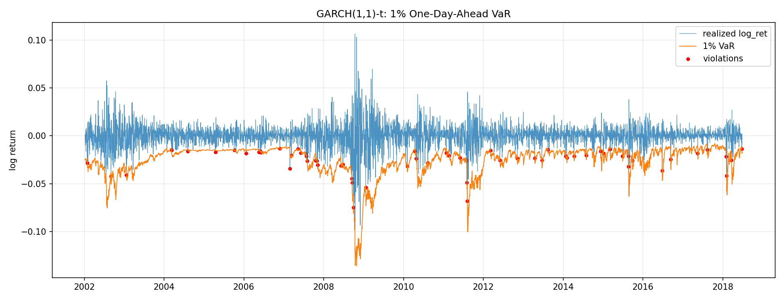
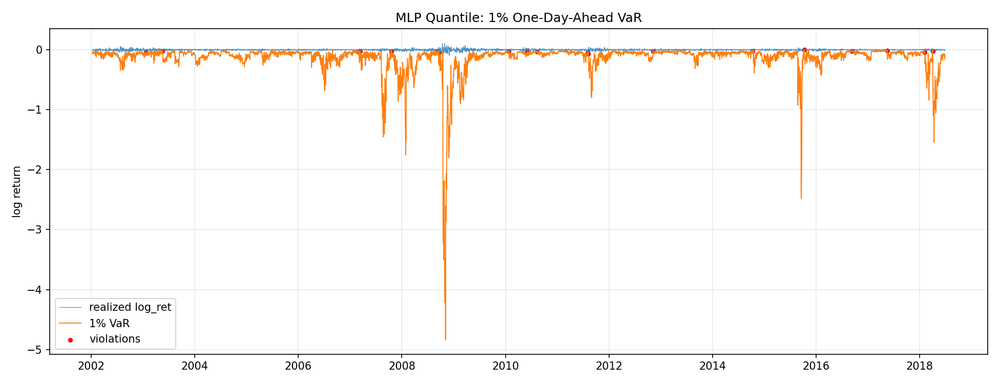

## SPY Value-at-Risk Forecasting Mini Program

This report studies one-day-ahead Value-at-Risk (VaR) forecasting for SPY daily returns. The goal is deliberately practical: build a clean empirical pipeline, compare classical econometric and neural quantile methods under the same rolling forecast design, and interpret the results with formal backtesting rather than visual fit alone.

The final comparison is organized around six parts: motivation, data, methodology, backtesting criteria, empirical results, and limitations. This structure is intended to make the project easy to audit: every model is connected to the same target variable, the same forecast timing, and the same statistical evaluation rules.

## 1. Introduction

### 1.1 Background of VaR

Value-at-Risk summarizes downside market risk through a conditional quantile. For a one-day horizon and tail probability alpha, VaR asks how negative tomorrow's return can be before it enters the worst alpha fraction of conditional outcomes. In risk management language, a correct 1% VaR forecast should be violated on about 1% of out-of-sample trading days. This makes VaR attractive for empirical testing: after forecasts are produced, their failures can be counted and tested.

VaR is not a complete description of tail risk. It does not measure the average size of losses beyond the threshold, and it can hide violation clustering. Still, it is a useful first object for this mini project because it forces a precise link between forecasting, statistical calibration, and model comparison.

### 1.2 Motivation for SPY tail-risk forecasting

SPY is a liquid equity-market ETF and is a natural benchmark for studying broad U.S. market downside risk. Its return series contains calm periods, the 2008 financial crisis, the COVID-19 shock, and other volatility regimes. A good VaR model therefore needs to do more than fit an unconditional distribution. It must adapt to changing volatility while staying calibrated in the tails.

The empirical question is simple: which type of model gives the most reliable one-day-ahead VaR forecasts for SPY at the 1%, 5%, and 10% levels?

### 1.3 Classical vs neural forecasting methods

The project compares two modelling traditions. Classical methods, such as Historical Simulation and GARCH-t, are transparent and statistically interpretable. They are strong baselines because they encode empirical tails or conditional volatility directly. Neural quantile methods are more flexible and can use realized-volatility variables such as rv5 and bv, but that flexibility can easily overfit when tail observations are scarce.

The final neural extension, Model C2, is therefore treated carefully. It is a GARCH-anchored neural correction rather than a black-box replacement for GARCH. Its hyperparameter setting was selected after inspecting out-of-sample backtesting behavior, so it should be read as a proof of concept, not as a fully pre-specified benchmark.

## 2. Data Description and Exploratory Analysis

### 2.1 Dataset description: log_ret, rv5, bv

The dataset contains 4,640 daily observations from 2000-01-04 onward. The target variable is the daily SPY log return. Two realized-volatility proxies are also used: rv5 and bv. These variables help describe market state and later serve as candidate inputs for neural and volatility-augmented models.

| Variable | Meaning | Use in the report |
| --- | --- | --- |
| log_ret | Daily SPY log return | Target variable for one-day-ahead VaR |
| rv5 | Five-minute realized variance proxy | Market-state input for volatility and neural models |
| bv | Bipower variation proxy | Robust realized-volatility input less sensitive to jumps |
| max(rv5 - bv, 0) | Simple positive jump proxy | Exploratory measure for discontinuous variation |

### 2.2 Descriptive statistics

The summary statistics show the basic difficulty of the problem. The mean daily return is close to zero, while the lower return quantiles are economically large. The return distribution is left-skewed and strongly leptokurtic, so a normal-distribution approximation is not a safe tail model.

| Variable | N | Mean | Std | Min | Q1% | Q5% | Q10% | Skew | Kurt |
| --- | --- | --- | --- | --- | --- | --- | --- | --- | --- |
| log_ret | 4640 | 0.000133 | 0.012013 | -0.0969 | -0.0345 | -0.0188 | -0.0129 | -0.208 | 8.22 |
| rv5 | 4640 | 0.000110 | 0.000248 | 0.0000 | 0.0000 | 0.0000 | 0.0000 | 11.717 | 245.05 |
| bv | 4640 | 0.000088 | 0.000207 | 0.0000 | 0.0000 | 0.0000 | 0.0000 | 11.457 | 214.83 |

### 2.3 Time-series plots

Figure 1 plots daily returns and rolling volatility. Large negative returns are not evenly spread across time. They arrive in episodes, which is exactly why a static quantile is unlikely to be enough for reliable VaR forecasting.

### 2.4 Distribution of returns

Figure 2 compares the empirical return distribution with normal-reference diagnostics. The lower tail is visibly heavier than a Gaussian benchmark, which motivates Historical Simulation, Student-t GARCH innovations, and quantile-based neural methods.

### 2.5 Volatility clustering

The autocorrelation diagnostics in Figure 3 show weak serial dependence in raw returns but much stronger dependence in squared returns. This is the standard volatility-clustering pattern and motivates conditional-volatility models such as GARCH.

### 2.6 Relationship between rv5 and bv

rv5 and bv move together because both measure realized variation, but they are not identical. rv5 captures total high-frequency variation, while bv is designed to be more robust to jumps. Their difference is useful as an exploratory signal of discontinuous movement.

### 2.7 Jump proxy: max(rv5 - bv, 0)

I use max(rv5 - bv, 0) as a simple jump proxy. It is not a formal jump test, but it is useful for visualizing days when total realized variation exceeds the bipower component. This proxy tends to rise during turbulent periods, so it is economically relevant for tail-risk forecasting.

## 3. Methodology and Rolling Forecast Design

### 3.1 VaR definition

Let r_(t+1) denote the next daily log return and F_t the information available at time t. The alpha-level VaR forecast is the conditional alpha-quantile of r_(t+1) given F_t. In this report VaR is reported as a negative return threshold. A violation occurs when the realized return falls below the forecasted VaR.

### 3.2 Rolling window setup

All forecasts are generated out of sample with rolling windows. The main classical baselines use a 1000-day rolling estimation window. At each forecast date, the model is estimated or updated using only past information, and then one-day-ahead VaR forecasts are produced at the 1%, 5%, and 10% tail levels.

Because Model C2 has a shorter available forecast history, the most important final comparison is made on the common C2-aligned window of 2,640 forecast days. This avoids the earlier evaluation-window problem in which some models were judged on 3,640 days while C2 was judged only from 2008 onward.

### 3.3 Feature construction

The feature set is intentionally simple and auditable. It uses lagged returns, realized-volatility proxies rv5 and bv, and, for the anchored neural specification, GARCH-implied state variables such as the GARCH VaR forecast and conditional volatility estimate. This keeps the neural model connected to financial-risk structure rather than treating it as an unconstrained curve fitter.

### 3.4 Historical Simulation

Historical Simulation estimates VaR directly from the empirical distribution of recent returns. It is transparent and requires few assumptions. I consider ordinary Historical Simulation, time-weighted Historical Simulation, and a KDE-smoothed time-weighted version. These models test how far empirical tail information can go without a conditional variance equation.

### 3.5 GARCH-t

The GARCH-t model introduces conditional volatility dynamics and heavy-tailed Student-t innovations. The GJR-GARCH-t extension adds an asymmetric leverage term, allowing negative shocks to affect volatility differently from positive shocks. These models are important because the data clearly show volatility clustering.

### 3.6 Quantile Regression

Quantile regression estimates conditional quantiles directly using the pinball loss. For VaR forecasting, this is a natural loss function because it rewards accurate tail-threshold forecasts rather than mean prediction.

### 3.7 MLP / QRNN

The neural quantile model uses a multilayer perceptron trained with pinball loss. The direct MLP model is flexible but fragile in the extreme tail, especially at 1%, where a 1000-day window contains only about ten tail observations. The GARCH-anchored extension, Model C2, is more structured: it starts from a GARCH-t VaR forecast and learns a one-sided softplus correction using return, realized-volatility, and GARCH state features.

## 4. Backtesting and Evaluation Criteria

### 4.1 Violation indicator

For each forecast, the violation indicator equals one if the realized return is below the VaR forecast and zero otherwise. A well-calibrated alpha-level VaR model should have an average violation rate close to alpha.

### 4.2 Failure rate

The failure rate is the sample mean of the violation indicator. It is the simplest calibration diagnostic and the first number to inspect. However, it only checks the total number of failures, not whether those failures arrive independently over time.

### 4.3 Kupiec test

The Kupiec unconditional coverage test evaluates whether the number of observed violations is statistically consistent with the nominal tail probability. A low p-value indicates that the model violates too often or too rarely.

### 4.4 Christoffersen test

The Christoffersen independence test evaluates whether violations are serially independent. This matters because a model can have the correct total number of failures while still failing repeatedly during crises.

### 4.5 Pinball loss

Pinball loss evaluates quantile forecast accuracy directly. It is especially useful when comparing neural quantile methods with classical VaR methods because it measures both the side and the magnitude of quantile forecast errors.

### 4.6 Model comparison rules

I use three rules. First, a model should have failure rates close to the nominal alpha levels. Second, Kupiec and Christoffersen p-values should not reject coverage or independence. Third, pinball loss and Diebold-Mariano comparisons help judge whether lower losses are statistically meaningful. The final conclusion gives priority to aligned-window evidence.

## 5. Empirical Results and Comparative Discussion

### 5.1 VaR forecast plots

The forecast plots show the main qualitative difference between model families. Historical Simulation follows empirical tail observations but can react slowly to regime changes. GARCH-t adapts through conditional volatility, while the direct MLP can become overly conservative or unstable. The anchored neural model is designed to keep the GARCH structure while correcting its calibration bias.

### 5.2 Failure rate table

The aligned failure-rate table is the cleanest calibration comparison because every model is evaluated on the same 2,640 forecast dates. Model C2 is closest to nominal coverage at 1% and 5%. At 10%, it is slightly conservative, while time-weighted Historical Simulation is closest in raw failure rate.

| Model | 1% | 5% | 10% |
| --- | --- | --- | --- |
| Ordinary HS | 1.55% | 5.30% | 9.55% |
| Time-weighted HS | 1.55% | 5.15% | 10.15% |
| KDE Time-weighted HS | 1.36% | 4.51% | 8.83% |
| GARCH-t | 1.55% | 6.55% | 11.48% |
| GJR-GARCH-t | 1.44% | 6.59% | 11.21% |
| Model C2 | 0.95% | 4.96% | 8.90% |

### 5.3 Backtesting test table

The p-value table gives a more formal view. Model C2 has strong Kupiec p-values at 1% and 5%, and a borderline but non-rejected value at 10%. Its 1% Christoffersen independence p-value remains weak, so I do not claim that it fully solves dynamic extreme-tail clustering.

| Model | K 1% | C 1% | K 5% | C 5% | K 10% | C 10% |
| --- | --- | --- | --- | --- | --- | --- |
| Ordinary HS | 0.0082 | 0.0003 | 0.4791 | 0.0012 | 0.4331 | <0.0001 |
| Time-weighted HS | 0.0082 | 0.0275 | 0.7222 | 0.6988 | 0.7957 | 0.7059 |
| KDE Time-weighted HS | 0.0752 | 0.0127 | 0.2381 | 0.2640 | 0.0406 | 0.4171 |
| GARCH-t | 0.0082 | 0.1632 | 0.0005 | 0.2654 | 0.0132 | 0.0535 |
| GJR-GARCH-t | 0.0333 | 0.5768 | 0.0003 | 0.2489 | 0.0413 | 0.0214 |
| Model C2 | 0.7823 | 0.0217 | 0.9288 | 0.5196 | 0.0557 | 0.4737 |

### 5.4 Pinball loss table

Pinball loss gives a different perspective from failure rates. GARCH-family models remain competitive on loss, especially against Model C2. This is why the conclusion should not be written as "neural methods dominate classical methods." The stronger conclusion is that the anchored neural correction improves unconditional calibration, while loss dominance over strong GARCH benchmarks is not uniform.

| Model | 1% | 5% | 10% |
| --- | --- | --- | --- |
| Ordinary HS | 0.000578 | 0.001650 | 0.002426 |
| Time-weighted HS | 0.000410 | 0.001329 | 0.002124 |
| KDE Time-weighted HS | 0.000400 | 0.001335 | 0.002119 |
| GARCH-t | 0.000356 | 0.001290 | 0.002069 |
| GJR-GARCH-t | 0.000336 | 0.001255 | 0.002041 |
| Model C2 | 0.000350 | 0.001266 | 0.002069 |

### 5.5 Diebold-Mariano comparison

The Diebold-Mariano tests compare Model C2 with selected benchmarks using pinball-loss differences. Negative values mean that Model C2 has lower average loss. The results are strongest against Historical Simulation variants and weaker against GARCH-family models.

| Benchmark | alpha | C2 loss minus benchmark | DM stat | p-value |
| --- | --- | --- | --- | --- |
| Time-weighted HS | 1% | -0.0000604 | -3.816 | 0.0001 |
| Time-weighted HS | 5% | -0.0000621 | -2.276 | 0.0228 |
| Time-weighted HS | 10% | -0.0000550 | -1.686 | 0.0918 |
| KDE Time-weighted HS | 1% | -0.0000501 | -3.870 | 0.0001 |
| KDE Time-weighted HS | 5% | -0.0000682 | -2.623 | 0.0087 |
| KDE Time-weighted HS | 10% | -0.0000495 | -1.609 | 0.1076 |
| GARCH-t | 1% | -0.0000064 | -0.923 | 0.3558 |
| GARCH-t | 5% | -0.0000238 | -1.296 | 0.1949 |
| GARCH-t | 10% | -0.0000001 | -0.006 | 0.9950 |
| GJR-GARCH-t | 1% | 0.0000131 | 1.630 | 0.1032 |
| GJR-GARCH-t | 5% | 0.0000117 | 0.671 | 0.5023 |
| GJR-GARCH-t | 10% | 0.0000280 | 1.261 | 0.2072 |

### 5.6 Classical vs neural model comparison

The direct MLP quantile model does not perform well as a standalone VaR model. It is too flexible relative to the small number of tail observations in each rolling window. By contrast, Model C2 is more defensible because it uses GARCH as an anchor and restricts the neural correction to move VaR in a conservative direction. This design uses neural flexibility where it is useful, but does not discard econometric structure.

The best model depends on the criterion. For unconditional coverage, Model C2 is the strongest overall specification. For independence at some levels, GARCH-type models remain competitive. For 10% raw failure rate, time-weighted Historical Simulation is very close to nominal. The empirical message is therefore balanced: neural methods help when they are structured and constrained, but classical models remain essential benchmarks.

## 6. Conclusion and Potential Improvements

### 6.1 Main findings

The project produces three main findings. First, SPY returns have heavy tails and volatility clustering, so static normal VaR is not an adequate benchmark. Second, GARCH-family models improve dynamic behavior but often underestimate the number of violations. Third, a GARCH-anchored neural correction can improve unconditional VaR calibration when the correction is constrained and interpreted carefully.

### 6.2 Best model at each VaR level

At the 1% level, Model C2 is the best model for unconditional coverage, with a failure rate of 0.95% and a Kupiec p-value of 0.7823, although its independence diagnostic remains weak. At the 5% level, Model C2 is again the most balanced model, with a 4.96% failure rate and acceptable Kupiec and Christoffersen p-values. At the 10% level, Model C2 is somewhat conservative at 8.90%; time-weighted Historical Simulation is closer in raw failure rate, but Model C2 remains competitive and interpretable.

### 6.3 Limitations

The most important limitation is the treatment of Model C2. Its final hyperparameter setting was selected after inspecting out-of-sample backtesting results. I therefore do not present its p-values as untouched test-sample evidence. A stricter study would fix the architecture and regularization rule before the final backtest, or use a separate validation period before the final out-of-sample evaluation.

Other limitations are also material. The 1% tail contains very few observations in each rolling window. The project uses only SPY daily data, so the ranking may not generalize to other assets. The neural training logs are not fully preserved for every rolling fit, which limits convergence auditing. Finally, VaR only measures threshold exceedance and does not directly measure expected loss beyond the threshold.

### 6.4 Future improvements

The next version should use a cleaner train-validation-test split, pre-register the neural hyperparameter protocol, and evaluate Expected Shortfall alongside VaR. It should also extend the dataset across multiple ETFs or asset classes, where graph-based spillover features could be tested more naturally. A stronger research version would combine realized-volatility forecasting, cross-asset dependence, and interpretable econometric-ML constraints rather than relying on an unconstrained neural model.

## References

Andersen, T. G., Bollerslev, T., Diebold, F. X., and Labys, P. (2003). Modeling and forecasting realized volatility. Econometrica, 71(2), 579-625.

Bollerslev, T. (1986). Generalized autoregressive conditional heteroskedasticity. Journal of Econometrics, 31(3), 307-327.

Christoffersen, P. F. (1998). Evaluating interval forecasts. International Economic Review, 39(4), 841-862.

Engle, R. F. (1982). Autoregressive conditional heteroskedasticity with estimates of the variance of United Kingdom inflation. Econometrica, 50(4), 987-1007.

Engle, R. F., and Manganelli, S. (2004). CAViaR: Conditional autoregressive value at risk by regression quantiles. Journal of Business & Economic Statistics, 22(4), 367-381.

Glosten, L. R., Jagannathan, R., and Runkle, D. E. (1993). On the relation between the expected value and the volatility of the nominal excess return on stocks. Journal of Finance, 48(5), 1779-1801.

Koenker, R., and Bassett, G. (1978). Regression quantiles. Econometrica, 46(1), 33-50.

Kupiec, P. H. (1995). Techniques for verifying the accuracy of risk measurement models. Journal of Derivatives, 3(2), 73-84.

Lopez, J. A. (1999). Regulatory evaluation of value-at-risk models. Journal of Risk, 1(2), 37-64.

